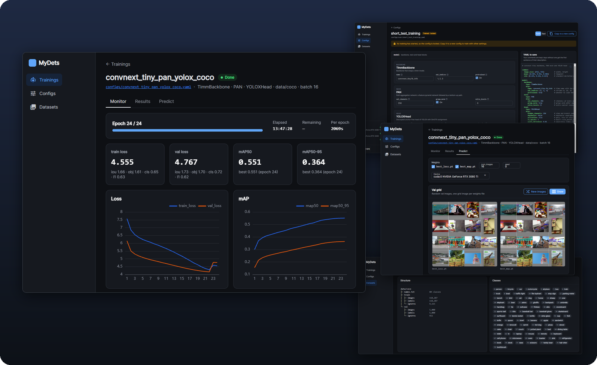
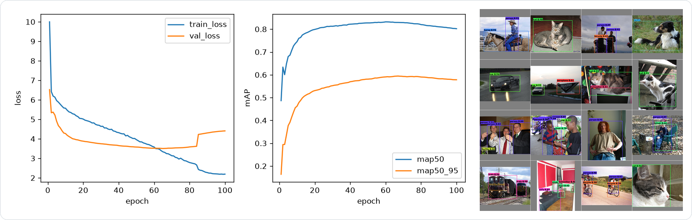
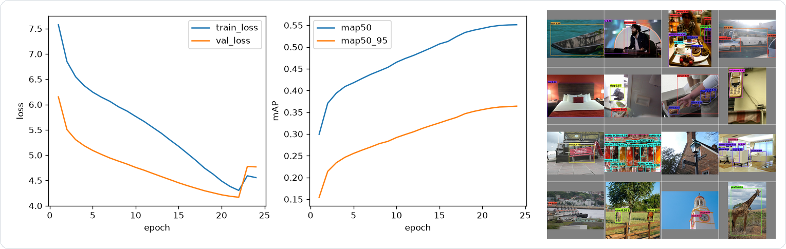

<picture>
  <source media="(prefers-color-scheme: dark)" srcset="assets/logo-dark.svg">
  
</picture>

# MyDets

My object detection framework aiming to be copyleft-free

## Why

- I needed a detection framework I can build my own way, without license worries
- Popular detection codebases are often copyleft (GPL, AGPL)
- I don't like projects like Ultralytics
  - They use the YOLO name as their own, with no real respect for its authors
  - AGPL for everyone, a paid license for commercial use
- I don't like heavy frameworks
  - Too many layers to follow
  - Their own package tools to install

## Goals

- No copyleft code
- Swappable backbone, neck and head
- Faithful to the original structures

## Components

| Part | Implementations |
| --- | --- |
| Backbone | timm models |
| Neck | PAN, BiFPN, CSPNeXtPAFPN, HybridEncoder |
| Head | YOLOX, TOOD, RTMDet, RetinaNet |

- I respect the original authors as much as I can
- Each part follows its original implementation as closely as possible
- Checked against the official code
- Small differences may remain

## Setup

Install [uv](https://docs.astral.sh/uv/)

```
pip install uv
```

If pip does not work, use the official installer

```
# Windows (PowerShell)
powershell -ExecutionPolicy ByPass -c "irm https://astral.sh/uv/install.ps1 | iex"

# Linux
curl -LsSf https://astral.sh/uv/install.sh | sh
```

Install the dependencies

```
uv sync
```

Supported devices

| Device | Status |
| --- | --- |
| NVIDIA GPU (Windows, Linux) | Supported, tested |
| CPU (Windows, Linux) | Supported, slow for training |
| AMD GPU (Linux) | Not blocked by the code, not tested yet |

- Uses the first GPU when available, the CPU otherwise
- `--device` picks one, such as `cuda:1` or `cpu`

## Usage

Two ways to use it: the web UI or the command line.
Both read the configs in `configs/` and the datasets in `data/`, and write to `runs/`, so a training started in one shows up in the other.

### Web UI

```
uv run webui\app.py
```

Opens http://localhost:8080 in the browser.



| Page | What it does |
| --- | --- |
| Trainings | Every training in `runs/`: start, stop or resume it on a chosen device, watch the loss, mAP and console, see the best weights and the report, draw predictions |
| Configs | Copy a config into `configs/user/`, edit it in a form or as text, then start its training |
| Datasets | Check the datasets in `data/` with their structure, classes and labels drawn on random images, and download VOC or COCO |

- Trainings and downloads keep going when the web UI is closed
- One training per device
- A config is locked once its training starts; copy it to train with other settings
- English and Korean, light and dark themes

### Command line

#### Quick start

```
uv run train_voc.py <config>
uv run train_coco.py <config>
```

| Script | Dataset | Config |
| --- | --- | --- |
| `train_voc.py` | PASCAL VOC 07+12 | `configs/*_voc.yaml` |
| `train_coco.py` | COCO 2017 | `configs/*_coco.yaml` |

- Downloads and converts the dataset on the first run
- Trains, draws predictions on 16 random val images and writes a report

Example

```
uv run train_voc.py configs\convnext_tiny_pan_yolox_voc.yaml
```

#### Train with your own data

##### 1. Prepare the dataset

```
my_dataset
├─ names.txt         one class name per line
├─ train
│  ├─ images         jpg, jpeg, png or bmp
│  └─ labels         one txt per image, same file name
└─ val
   ├─ images
   ├─ labels
   └─ ignores        optional, boxes ignored in evaluation
```

Label file, one box per line

```
class cx cy w h
```

- `class`: line index in `names.txt`, from 0
- `cx cy w h`: box center and size, normalized to 0~1 by the image width and height
- No objects: an empty file, or no file

```
0 0.512 0.430 0.210 0.380
2 0.150 0.700 0.120 0.300
```

##### 2. Make a config

- Copy a config in `configs/`
- Change `train.dataset_dir` to your dataset

```yaml
train:
  dataset_dir: data/my_dataset
  epochs: 100
  batch_size: 16
```

| Section | Content |
| --- | --- |
| `common` | input size and normalization |
| `model` | backbone, neck and head with their arguments |
| `train` | dataset, schedule, augmentation |
| `predict` | score threshold and transforms for inference |

##### 3. Train

```
uv run train.py configs\my_model.yaml
uv run train.py configs\my_model.yaml --device cuda:1
```

- Saves in `runs/<config name>/`
- Running again resumes from `last.pt`, also on another device

##### 4. Predict

```
uv run predict.py runs\my_model <image or folder>
uv run predict.py runs\my_model <folder> --weights best_map.pt --num-images 9 --seed 1
```

| Input | Output |
| --- | --- |
| Image | Boxes drawn on the image |
| Folder | 16 random images in a 4x4 grid |

| Option | Default | Content |
| --- | --- | --- |
| `--weights` | `best_loss.pt best_map.pt` | weights to draw with |
| `--num-images` | 16 | images in the grid |
| `--seed` | 0 | the same seed picks the same images |
| `--device` | first GPU or CPU | device to run on |

- One result per weights
- Saved in `runs/<config name>/predict/`

##### 5. Report

```
uv run report.py runs\my_model
```

- Model, data, training settings, time and best results in one summary
- Saves as `runs/<config name>/report.txt`

## Example runs

- Model: ConvNeXt-T, PAN and YOLOX, input 416×416
- Configs: `convnext_tiny_pan_yolox_voc` and `convnext_tiny_pan_yolox_coco`
- mAP: on the val split, by pycocotools

| Train → val | Epochs | Best epoch | mAP50-95 | mAP50 | Time |
| --- | --- | --- | --- | --- | --- |
| VOC 07+12 → 07 test | 100 | 67 | 0.594 | 0.829 | 9.4 h |
| COCO 2017 train → val | 24 | 24 | 0.364 | 0.551 | 13.8 h |





<sub>Loss and mAP per epoch, and `best_map.pt` on 16 random val images. VOC above, COCO below.</sub>

Still looking for better settings.

## Outputs

```
runs/<config name>
├─ best_loss.pt       weights of the best val loss
├─ best_map.pt        weights of the best mAP50:95
├─ last.pt            state to resume
├─ log.csv            losses and mAP of every epoch
├─ curve.png          loss and mAP curves
├─ result.json        records of the two bests
├─ config.yaml        copy for predict and report
├─ names.txt          copy for predict and report
├─ predict/           drawn predictions
├─ report.txt         summary of the run
├─ console.log        output of a training started from the web UI
└─ train.pid          process of a training started from the web UI
```

## License

- Apache-2.0
- Third party code: `THIRD_PARTY_NOTICES.txt`
