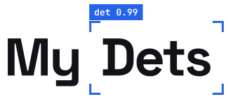

<picture>
  <source media="(prefers-color-scheme: dark)" srcset="assets/logo-dark.svg">
  
</picture>

# MyDets

My object detection framework aiming to be copyleft-free

## Why

- I needed a detection framework I can build my own way, without license worries
- Popular detection codebases are often copyleft (GPL, AGPL)
- I don't like projects like Ultralytics
  - They use the YOLO name as their own, with no real respect for its authors
  - AGPL for everyone, a paid license for commercial use
- I don't like heavy frameworks
  - Too many layers to follow
  - Their own package tools to install

## Goals

- No copyleft code
- Swappable backbone, neck and head
- Faithful to the original structures

## Components

| Part | Implementations |
| --- | --- |
| Backbone | timm models |
| Neck | PAN, BiFPN, CSPNeXtPAFPN, HybridEncoder |
| Head | YOLOX, TOOD, RTMDet, RetinaNet |

- I respect the original authors as much as I can
- Each part follows its original implementation as closely as possible
- Checked against the official code
- Small differences may remain

## Usage

### Setup

```
uv sync
```

### Train

```
uv run train.py <config>
uv run train_voc.py <config>
```

- `train_voc.py`: downloads PASCAL VOC first, needs a `*_voc.yaml` config

### Predict

```
uv run predict.py <run_dir> <image or folder>
```

- Image: one result
- Folder: 16 random images in a grid

### Example

```
uv run train_voc.py configs\convnext_tiny_pan_yolox_voc.yaml
uv run predict.py runs\convnext_tiny_pan_yolox_voc data\voc\val\images
```

## License

- Apache-2.0
- Third party code: `THIRD_PARTY_NOTICES.txt`
